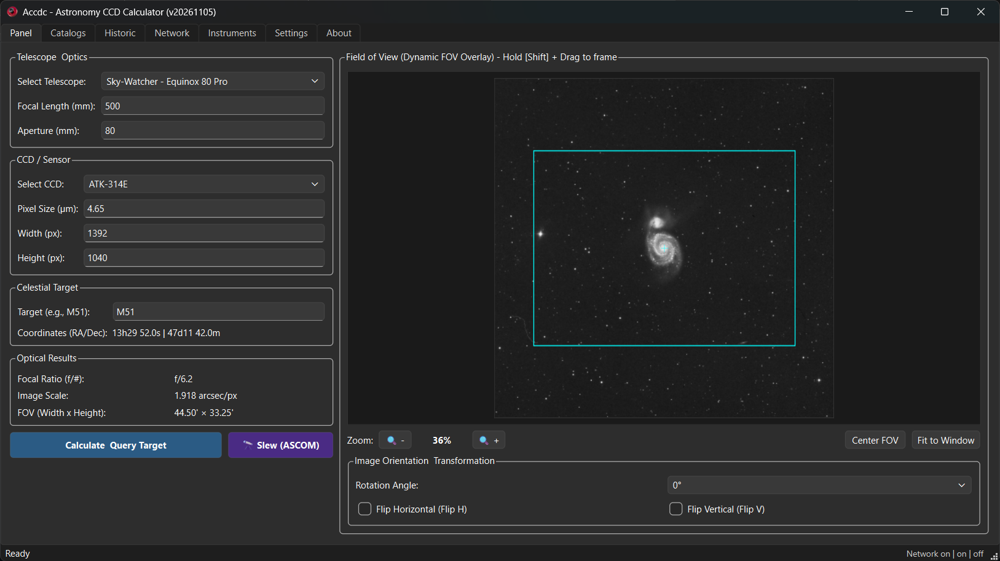

# Accdc - Astronomy CCD Calculator

<p align="center">
  
</p>

<p align="center">
  <strong>Astronomical Field of View (FOV) & Image Scale Calculator for Astrophotography</strong>
</p>

<p align="center">
  
  
  
  
</p>
<p align="center">
  
</p>

---

## 🔭 Overview

**Accdc** (*Astronomy CCD Calculator*) is an open-source desktop application built with Python and PySide6 (Qt6) designed for amateur astronomers and astrophotographers. It helps you accurately simulate, plan, and visualize how deep-sky objects (nebulae, galaxies, star clusters) fit into your telescope and camera sensor frame.

Beyond optical formulas, Accdc queries astronomical databases (SIMBAD / NED via Astroquery) and automatically fetches real sky survey imagery (STScI Digitized Sky Survey - DSS). It projects an interactive sensor field-of-view (FOV) rectangle over the sky background, complete with real-time rotation, pan/drag offsets, optical flips, and smooth zooming.

---

## ✨ Features

- **Real-Time Optical Calculations:**
  - Image Scale in arcseconds per pixel.
  - Field of View in arcminutes and degrees.
  - Telescope focal ratio.
- **Interactive FOV Sky Visualizer:**
  - Automatic download and caching of DSS sky survey images for any celestial target.
  - Interactive sensor rectangle overlay rendered accurately to scale.
  - Sensor camera rotation angle adjustment (0° to 360°).
  - Horizontal & Vertical flips (*Flip H / Flip V*) to match optical trains (refractors, diagonals, Newtonians).
  - Drag-and-drop panning and mouse-wheel zoom on the sky canvas.
- **Equipment Management:**
  - Save and organize telescope profiles (aperture, focal length).
  - Save and organize CCD / CMOS camera profiles (resolution width/height, pixel size in $\mu\text{m}$).
- **Target Search & Coordinate Resolution:**
  - Fast search by catalog identifier or common name (e.g., M31, NGC 7000, Horsehead Nebula).
  - Automatic resolution of Right Ascension (RA) and Declination (Dec).
- **Target History & Network Sync:**
  - Local history log of recently queried celestial targets.
  - *Network* tab providing community sync of observations and target queries using Firebase Realtime Database.

---

## 🛠️ Tech Stack

- **Core Language:** Python 3.10+
- **GUI Framework:** [PySide6](https://pypi.org/project/PySide6/) (Qt 6)
- **Astronomy Libraries:** [Astropy](https://www.astropy.org/) & [Astroquery](https://astroquery.readthedocs.io/)
- **Image Processing:** [Pillow (PIL)](https://python-pillow.org/)
- **Cloud Synchronization:** Firebase Realtime Database REST API

---

## 🚀 Installation & Running from Source

### 1. Clone the Repository
```bash
git clone https://github.com/ruirigel/accdc.git
cd accdc
```

### 2. Create and Activate a Virtual Environment
```bash
# Windows (PowerShell)
python -m venv .venv
.\.venv\Scripts\Activate.ps1

# Linux / macOS
python3 -m venv .venv
source .venv/bin/activate
```

### 3. Install Dependencies
```bash
pip install --upgrade pip
pip install -r requirements.txt
```

### 4. Run the Application
```bash
python -m ui.main_window
```

---

## 📦 Building Standalone Executables Across Platforms

Accdc can be compiled into a standalone, single-file executable using **[PyInstaller](https://pyinstaller.org/)**.

> [!NOTE]
> **Important:** PyInstaller creates binaries native to the operating system it runs on (it is not a cross-compiler). To build a Windows `.exe`, compile on Windows. To build a Linux binary, compile on Linux. To build a macOS `.app`, compile on macOS.
>
> To automate multi-platform builds without needing separate machines, see the [GitHub Actions CI/CD](#-automated-cross-platform-builds-github-actions) section below.

---

### 1. Windows Build (`.exe`)

On Windows, run PyInstaller using the provided `.spec` file:

```powershell
# Activate your virtual environment first
.\.venv\Scripts\activate

# Build using the spec configuration
pyinstaller main_window.spec
```

The output standalone executable `main_window.exe` will be located in the `dist/` folder, complete with the embedded application icon (`assets/logo.ico`).

---

### 2. Linux Build (`binary` / `AppImage`)

#### Prerequisites (Debian / Ubuntu / Mint):
Install the required system libraries for Qt6 and OpenGL:
```bash
sudo apt update
sudo apt install -y build-essential libgl1-mesa-dev libglib2.0-0 libxcb-xinerama0 libxcb-cursor0
```

#### Build Command:
```bash
# Activate your virtual environment
source .venv/bin/activate

# Build executable
pyinstaller --clean -y \
  --name "accdc" \
  --windowed \
  --collect-all core \
  --collect-all ui \
  ui/main_window.py
```
The resulting binary `accdc` will be generated in `dist/`.

*(Optional)* You can wrap the resulting binary into a portable `.AppImage` using [appimagetool](https://appimage.github.io/).

---

### 3. macOS Build (`.app` / `.dmg`)

#### Prerequisites:
Convert the icon to Apple ICNS format (`assets/logo.icns`), or omit the icon parameter:
```bash
# Activate virtual environment
source .venv/bin/activate

# Build application bundle
pyinstaller --clean -y \
  --name "Accdc" \
  --windowed \
  --collect-all core \
  --collect-all ui \
  --icon="assets/logo.ico" \
  ui/main_window.py
```
This generates a native macOS application bundle `dist/Accdc.app`.

*(Optional)* To create a `.dmg` installer disk image, install `create-dmg`:
```bash
brew install create-dmg
create-dmg --volname "Accdc Installer" "dist/Accdc.dmg" "dist/Accdc.app"
```

---

### 🤖 Automated Cross-Platform Builds (GitHub Actions)

The easiest way to generate binaries for **Windows, Linux, and macOS simultaneously** is using a GitHub Actions workflow.

Create a file named `.github/workflows/build.yml` in your repository:

```yaml
name: Build Cross-Platform Binaries

on:
  push:
    tags:
      - 'v*'
  workflow_dispatch:

jobs:
  build:
    strategy:
      matrix:
        include:
          - os: windows-latest
            artifact_name: accdc-windows.exe
            build_cmd: pyinstaller main_window.spec
            binary_path: dist/main_window.exe

          - os: ubuntu-latest
            artifact_name: accdc-linux
            build_cmd: pyinstaller --clean -y --name accdc --windowed --collect-all core --collect-all ui ui/main_window.py
            binary_path: dist/accdc

          - os: macos-latest
            artifact_name: accdc-macos.zip
            build_cmd: |
              pyinstaller --clean -y --name Accdc --windowed --collect-all core --collect-all ui ui/main_window.py
              ditto -c -k --keepParent dist/Accdc.app dist/accdc-macos.zip
            binary_path: dist/accdc-macos.zip

    runs-on: ${{ matrix.os }}

    steps:
      - name: Checkout Code
        uses: actions/checkout@v4

      - name: Set up Python
        uses: actions/setup-python@v5
        with:
          python-version: '3.11'

      - name: Install System Dependencies (Linux)
        if: runner.os == 'Linux'
        run: |
          sudo apt-get update
          sudo apt-get install -y libgl1-mesa-glx libxcb-xinerama0 libxcb-cursor0

      - name: Install Python Dependencies
        run: |
          python -m pip install --upgrade pip
          pip install -r requirements.txt
          pip install pyinstaller

      - name: Build Executable
        run: ${{ matrix.build_cmd }}

      - name: Upload Artifact
        uses: actions/upload-artifact@v4
        with:
          name: ${{ matrix.artifact_name }}
          path: ${{ matrix.binary_path }}
```

Whenever you push a tag (e.g. `v20261105`) or trigger the workflow manually from GitHub's **Actions** tab, GitHub will spin up Windows, Linux, and macOS virtual machines, build the binaries, and make them available for download automatically!

---

## 📂 Project Structure

```text
accdc/
├── assets/             # Application icons and branding assets
├── core/               # Business logic, optical formulas & network queries
│   ├── calculator.py   # Optical math (scale, FOV, focal ratio)
│   ├── firebase_sync.py# Firebase network logging and status verification
│   ├── query.py        # Astronomical coordinates query and DSS image fetching
│   ├── storage.py      # Persistence for instruments, settings and logs
│   └── version.py      # Application version definition
├── data/
│   └── instruments.json# Default instrument database (telescopes & sensors)
├── ui/
│   └── main_window.py  # PySide6 GUI interface implementation
├── .gitignore          # Git exclusion rules
├── create_release.py   # Automated release versioning helper
├── main_window.spec    # PyInstaller Windows build specification
├── requirements.txt    # Production dependencies
└── README.md           # Project documentation
```

---

## 📄 License

This project is open-source software licensed under the **MIT License**.

---

## 👤 Author

Developed by **Rui Branco** ([@ruirigel](https://github.com/ruirigel)).
Contributions, bug reports, and suggestions are welcome via [GitHub Issues](https://github.com/ruirigel/accdc/issues)!
